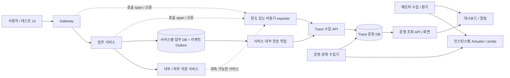

# MSA 처리 흐름·오류·서비스 상태 기반 설계

- 상태: 제안 설계. 구현 완료 또는 운영 적합성 검증을 의미하지 않는다.
- 적용 범위: Java 25 기반의 현재 서비스와 차세대 프로젝트에서 재사용할 관측·운영 기반.
- 초기 구성: 서비스별 DB + 중앙 Trace/운영 조회 + HTTP 수집 + 상태 점검. Redis·Kafka는 추후 도입한다.
- 운영 저장소: PostgreSQL을 기본 제안으로 하고, H2는 로컬·테스트 전용으로 사용한다. 용량과 운영 표준에 따라 확정한다.

## 1. 목표와 구분

| 사용자 요구 | 운영자가 답할 수 있어야 하는 질문 | 판정 근거 |
|---|---|---|
| 처리 flow 추적 | 업무가 어디까지 진행됐고 어느 호출에서 지연됐는가? | 업무 프로세스·단계 상태 + 호출 span과 시간 |
| 오류 추적 | 어떤 요청이 왜 실패했고 영향 범위는 어디까지인가? | 구조화 오류·원인 서비스·동일 오류 집계 + Trace 연결 |
| 서비스 장애 여부 | 어느 인스턴스가 응답하지 않으며 서비스 전체는 사용 가능한가? | 상태 probe + 실제 요청 지표 + 수집 신선도 |

업무 실패, 기술 오류, 서비스 장애는 별도로 판정한다. 비활성 직원의 가입 거부는 정상적인 업무 거부이고, HR 호출 Timeout은 특정 요청의 기술 오류이며, 지속적인 HR 가용성 저하는 서비스 장애 후보이다. 요청 한 건의 실패로 서비스 전체를 DOWN 처리하지 않는다.

## 2. 구성과 책임

| 구성 | 책임 | 경계 |
|---|---|---|
| Gateway | 진입 인증, Trace 문맥 생성·검증·전파, 호출 관측 | 업무 단계 상태를 직접 확정하지 않음 |
| 업무 서비스 | 업무 상태의 원본, 단계·실패 기록, 하위 호출 문맥 전파 | 다른 서비스의 DB를 직접 수정하지 않음 |
| `msa-core` | 이벤트 계약, 식별자·오류 분류 규약 | 업무 오케스트레이션과 범용 프레임워크를 넣지 않음 |
| 서비스 내부 계측 설정 | MVC/Feign/WebClient 및 Reactor 문맥 연결 | 검증된 자동 계측 우선, 중복 span 생성 방지 |
| `trace-service` | 수집·중복 제거·조회용 projection·오류 집계 | 업무 성공 여부의 원본이 되지 않음 |
| 상태 수집기 | 인스턴스 목록과 probe 관측·신선도·상태 전이 | 초기는 trace-service의 별도 패키지/작업으로 구성 |
| 메트릭·알림 도구 | Prometheus 계열 지표 수집, 대시보드, 임계치 평가·알림 | Trace 조회 장애와 독립적으로 서비스 이상 탐지 |
| 운영 UI | flow·오류·서비스 상태 간 이동 | 초기는 test-service 화면을 활용, 운영 화면은 권한·용도를 분리 |

처음부터 별도 서비스 수를 늘리지 않는다. 수집량·장애 격리·운영 조직 요구가 확인되면 수집과 조회, 상태 수집기를 분리한다. 서비스별 DB 소유권은 유지한다.

## 3. 식별자와 문맥 전파

| 식별자 | 의미와 수명 | 규칙 |
|---|---|---|
| `traceId` | 한 분산 실행의 호출 트리 | W3C Trace Context의 32자리 hex, 유효한 상위 문맥은 유지 |
| `spanId` / `parentSpanId` | 실행·호출 단위와 부모 | 16자리 hex, 재시도 호출마다 별도 span |
| `processId` | 회원가입 등 업무 인스턴스 | 재시도·재개로 여러 Trace가 생겨도 같은 업무에 연결 |
| `stepExecutionId` / `parentStepExecutionId` | 업무 단계 실행·하위 단계 | 반복·병렬 단계 구분, 정의상 단계 코드인 stepId와 분리 |
| `eventId` | 이벤트 중복 제거 키 | 발행 시 생성한 UUID를 재전송에도 유지 |
| `errorId` / `errorGroupId` | 오류 발생 한 건 / 동일 유형 집계 | 사용자 응답은 errorId, 상세 원인은 권한 있는 조회로 제공 |
| `serviceName` / `instanceId` / `deploymentVersion` | 서비스·실행 인스턴스·배포 | 재시작 시 instanceId 변경, 배포 버전으로 회귀 추적 |

- 표준 전파는 `traceparent`와 `tracestate`를 사용한다. `X-Trace-Id`는 기존 클라이언트 호환 응답 헤더로 유지한다.
- 유효한 traceparent를 우선한다. 이전 16자리 X-Trace-Id만 들어오면 표준 traceId를 새로 발급하고 기존 값은 제한된 legacy correlation 필드로 연결한다. 임의 문자열을 표준 ID로 취급하지 않는다.
- Gateway, Servlet, Reactor, Feign, 비동기 executor 경계에서 전파한다. ThreadLocal만으로 Reactor 문맥을 처리하지 않는다.
- OpenTelemetry/Micrometer의 지원 계측을 우선하고 한 호출이 중복 기록되지 않게 한다. 선택한 조합을 Java 25·Boot 4에서 검증한다.
- processId 등 업무 문맥은 검증한 내부 계약으로 전달한다. 외부에서 받은 식별자와 baggage를 신뢰해 권한·테넌트를 결정하지 않는다.
- 타임스탬프는 UTC, 소요 시간은 프로세스 내 단조 시계로 측정한다. 서비스 간 시각만으로 인과관계를 추론하지 않는다.

## 4. 처리 flow 모델

### 4.1 업무 흐름과 기술 호출을 연결

예시 업무: `MEMBER_SIGNUP` → `CHECK_HR_EMPLOYEE` → `SAVE_MEMBER`.

업무 단계는 사용자 의미를, span은 HTTP·DB 등 실행을 설명한다. 같은 processId에 여러 Trace가 연결될 수 있으며, 실제로 호출하지 않은 샘플 단계는 외부 호출 성공으로 표시하지 않는다.

| 대상 | 상태 | 전이 규칙 |
|---|---|---|
| 프로세스 | RUNNING, SUCCEEDED, REJECTED, FAILED, TIMED_OUT, CANCELLED | RUNNING에서 종료 상태로 전이, 재개는 별도 실행/attempt로 기록 |
| 단계 실행 | PENDING, RUNNING, SUCCEEDED, REJECTED, FAILED, TIMED_OUT, SKIPPED, CANCELLED | PENDING → RUNNING → 종료, 선행 실패로 미실행이면 SKIPPED |
| span | UNSET, OK, ERROR | OpenTelemetry 규약 적용, HTTP 코드·업무 결과는 별도 필드 |

- 버전 관리하는 프로세스/단계 정의에 단계 코드, 의존 단계, Timeout, 필수 여부를 둔다. 초기에는 서비스의 명시적 정의로 시작하고 동적 워크플로 엔진은 도입하지 않는다.
- 병렬 실행은 parentStepExecutionId와 의존 관계로 표현한다. 시간 순 목록만으로 직렬 호출처럼 표시하지 않는다.
- 업무 DB의 상태와 중요 이벤트를 같은 로컬 트랜잭션에 저장한다. 원격 호출 전체에 장기 DB 트랜잭션을 유지하지 않는다.
- 종료 이벤트가 없으면 우선 `INCOMPLETE` 수집 상태로 표시한다. 수집 지연만으로 업무 FAILED를 생성하지 않는다.
- 단계별 deadline을 넘기면 업무 서비스의 복구 작업이 원본 상태를 확인해 종료·재개한다. 중앙 조회는 원본과 대조하며 필요 시 명시적인 보정 이벤트를 반영한다.
- 단일 요청의 transport Retry와 업무 재실행 attempt를 구분하고 idempotency 키로 중복 부작용을 방지한다.

### 4.2 최소 이벤트 계약

필수 envelope: `schemaVersion`, `eventId`, `eventType`, `occurredAt`, `receivedAt`(수집기 부여), `environment`, `serviceName`, `instanceId`, `deploymentVersion`.

업무 이벤트: `processId`, `processType`, `processDefinitionVersion`, `aggregateVersion`, `stepId`, `stepExecutionId`, `attempt`, `status`, `traceId`, `spanId`, `durationMs`, 허용된 업무 식별자.

호출 이벤트: `traceId`, `spanId`, `parentSpanId`, span kind, 호출 대상, HTTP method, 정규화한 route, HTTP status, duration, outcome.

오류 이벤트: `errorId`, `errorGroupId`, `errorCode`, `errorCategory`, `originService`, 예외 유형, 마스킹된 메시지, 허용된 stack, 관련 process/span, retryable.

이벤트 종류는 `PROCESS_STARTED/FINISHED`, `STEP_STARTED/FINISHED`, `ERROR_RECORDED` 등을 버전 계약으로 정의한다. span은 표준 exporter의 OTLP 계약 사용을 우선하며 업무 이벤트와 중복 저장 범위를 정한다.

## 5. 오류 추적

| 분류 | 예시 | 처리와 표시 |
|---|---|---|
| BUSINESS | 비활성 직원, 중복 가입 | REJECTED, 업무 코드와 안내, 가용성 오류율에서 분리 |
| VALIDATION / AUTH | 입력 누락, 인증·권한 거부 | 400/401/403, 민감정보 제외, 보안 이상은 별도 탐지 |
| DEPENDENCY | 하위 서비스 5xx·연결 실패 | 호출 대상·호출 span·원인 오류 연결 |
| TIMEOUT | HR 응답 deadline 초과 | TIMED_OUT, 예산·실제 소요 시간 기록 |
| DATA / INTERNAL | DB 오류, 처리되지 않은 예외 | FAILED, 상세 원인은 운영 권한으로 제한 |

- `errorGroupId`는 서비스·배포/코드 위치·예외 유형·정규화 코드 등 안정적인 요소로 만든다. 사용자 입력·ID가 포함된 메시지 원문을 집계 키로 쓰지 않는다.
- 원인 오류와 전파된 오류는 `causedByErrorId`로 연결한다. 원인 서비스가 모호하면 추정이라고 표시하고 임의로 단정하지 않는다.
- 알려진 업무 거부를 500 또는 Timeout으로 기록하지 않는다. HTTP 정상 완료라도 5xx는 호출 성공으로 처리하지 않는다.
- 외부 오류 응답은 안전한 `code`, `message`, `errorId`, `traceId`를 제공한다. stack·SQL·비밀번호·토큰은 제외한다.
- 서비스/배포/오류 그룹별 발생량·영향받은 업무 수·최초/최근 시각을 집계한다. 수집 중복 제거와 호출별 오류 집계로 중복 알림을 줄인다.

## 6. 서비스 장애 여부 판정

### 6.1 관측 원천

- Liveness: 프로세스 자체의 회복 불가능 상태. 하위 서비스/DB 장애를 이유로 재시작 루프를 만들지 않는다.
- Readiness: 인스턴스가 요청을 받을 수 있는지. 해당 서비스에 필수인 의존성만 포함한다.
- 실제 요청: 오류율, p95/p99 지연, Timeout, Circuit Breaker 상태. probe 성공만으로 업무 정상이라고 판단하지 않는다.
- Synthetic check: 계정·데이터를 통제한 읽기 또는 부작용 없는 대표 업무 확인. 업무 실패를 서비스 장애와 구분한다.
- 수집 신선도: 마지막 관측 시각, 수집기 자체 상태, 누락 구간. 요청이 없다는 사실은 장애 증거가 아니다.

### 6.2 인스턴스와 서비스 상태

| 상태 | 인스턴스 판단 | 서비스 전체 판단 |
|---|---|---|
| UP | 유효한 readiness 성공, 신선한 관측 | 가용 인스턴스와 대표 요청 지표가 정책 충족 |
| DEGRADED | 응답하지만 지연·오류·의존성 이상 | 일부 인스턴스/업무 경로 문제 또는 SLO 악화 |
| DOWN | 연속 probe 실패로 대상 도달 불가/수용 불가 관측 | 필요한 용량의 가용 인스턴스가 없고 요청 경로 실패가 확인됨 |
| UNKNOWN | 등록 직후·관측 만료·수집기 장애 | 판정할 최신 근거가 없음 |

DOWN은 관측 위치에서 사용할 수 없다는 뜻이며 프로세스가 죽었다는 단정은 아니다. 네트워크 분리와 수집기 장애도 원인 후보로 표시한다. 인스턴스 일부의 DOWN을 서비스 전체 DOWN으로 올리지 않는다.

초기 검증값은 probe 10초, probe timeout 2초, 연속 3회 실패 후 DOWN 후보, 30초 관측 만료 시 UNKNOWN, 연속 2회 성공 후 복구로 둔다. 이는 확정 운영 SLA가 아니며 부하·오탐·탐지 지연 시험으로 조정한다. 대상 실패 응답은 신선한 실패 관측이며, 관측 자체가 멈춘 경우와 구분한다.

- 인스턴스 목록은 초기에 환경별 명시적 설정, 운영에서는 플랫폼/Service Discovery의 기대 인스턴스 목록을 사용한다. 로드밸런서 주소만 probe해서 모든 인스턴스를 정상으로 판단하지 않는다.
- 수집기는 허용 목록의 인스턴스만 조회하고 timeout·동시성·최대 응답 크기를 제한한다.
- 오류율/지연 판정은 최소 요청 수와 여러 관측 구간을 요구한다. 무트래픽은 N/A 또는 probe 기준으로 표시한다.
- 수집기 장애는 별도의 외부 메트릭/알림 체계가 탐지한다. 중앙 Trace 서비스의 자기 보고만으로 자기 가용성을 증명하지 않는다.
- 계획 정비·배포와 기대 인스턴스 수를 반영하고 원본 관측과 판단 정책 버전을 보관한다.

## 7. 수집 신뢰성과 데이터 소유권

### 7.1 Redis/Kafka 없는 초기 구조

1. 업무 상태·중요 업무 이벤트는 업무 DB와 Outbox에 함께 저장한다.
2. 서비스 내부 전송 작업이 HTTP batch로 중앙에 보낸다. 중앙은 영속화 이후에만 항목별 승인한다.
3. 중앙은 `(environment, serviceName, eventId)` 유일 제약으로 중복을 제거한다. 전송은 at-least-once이며 exactly-once를 주장하지 않는다.
4. 승인된 Outbox만 완료 처리하고, 실패 항목은 제한된 backoff와 jitter로 재전송한다. 영구적인 계약 오류는 격리하고 운영자가 확인한다.
5. 같은 aggregate의 버전과 기대 상태 전이로 projection을 갱신한다. 지연·중복·순서 역전은 감지·보류·재조정하며 수집 순서로 업무 상태를 덮어쓰지 않는다.

Outbox 용량·보관 기간·최대 재시도·고수위 알림을 정의한다. 필수 업무 이력을 저장할 수 없으면 해당 업무를 원자적으로 실패시키는 정책을 기본으로 하며, 중앙 수집 지연만으로 업무를 중단하지 않는다. 저장 공간 고갈 시 무조건 유실 없이 계속 처리할 수 있다고 가정하지 않는다.

기술 span·구조화 로그는 한도 있는 비동기 buffer/exporter로 수집한다. 포화·프로세스 종료 시 유실될 수 있으며 dropped count·전송 실패·마지막 성공 시각을 측정한다. 중요 업무 이력의 내구성과 기술 Trace의 best-effort 수집을 분리한다. WebFlux 이벤트 루프에서 `block()`하거나 수집 성공을 동기 대기하지 않는다.

### 7.2 보존과 성능

- 중요 업무 이벤트는 100% 기록한다. 기술 span은 초기 100%로 검증하되 운영 부하에서 샘플링한다. 모든 오류 Trace 보존이 필요하면 tail sampling 등 별도 수집 정책을 검증한다.
- DB 쓰기는 batch, 조회는 기간 제한·cursor pagination을 기본으로 한다. 전체 무제한 목록 조회는 운영에서 차단한다.
- 보관 기간의 초기 제안은 상세 span/stack 14일, 업무 흐름·오류 90일, 집계 1년이다. 실제 정책은 개인정보·업무·비용 요구로 확정한다.
- 시간 파티션, 기간 만료 정리, 조회 인덱스 및 운영 DB 백업·복원을 검증한다.
- 용량은 peak RPS × 요청당 span/event 수 × 평균 저장 크기 × 보관 기간으로 산정하고 인덱스·복제·여유 공간을 추가한다. 수치는 대상 부하 측정 후 확정한다.

## 8. 논리 저장 모델

물리 DDL은 승인된 DB와 용량 시험 결과에 맞춰 별도 마이그레이션으로 작성한다.

| 모델 | 핵심 키/필드 | 주요 제약·조회 |
|---|---|---|
| 업무 서비스 `process`, `step_execution` | processId, 단계 실행 ID, 상태, version, deadline | 원본 상태, 업무 키의 중복 처리 규칙 |
| 업무 서비스 `observation_outbox` | eventId, payload/version, 시도·다음 시각, 승인 상태 | eventId unique, 전송 대상 인덱스 |
| 중앙 `observation_event` | eventId, envelope, process/span/error 참조 | 발행 서비스별 eventId unique, 수신/발생 시각 분리 |
| 중앙 `process_projection`, `step_projection` | processId, stepExecutionId, version, completeness | 기간/업무 유형/상태, 원본 대조 시각 |
| 중앙 `trace_span` 또는 표준 Trace backend | traceId, spanId, parentSpanId, duration | trace/span unique, 서비스·기간 조회 |
| 중앙 `error_occurrence`, `error_group` | errorId, groupId, category, causal 참조 | 오류 그룹·기간·서비스·배포, process/trace 역조회 |
| 중앙 `service_instance` | 환경, 서비스, instanceId, 배포, 기대 수명 | 기대 목록과 관측의 분리 |
| 중앙 `health_observation`, `service_state_history` | 관측 대상·시각·출처·결과, 정책 버전 | 최신 관측·상태 전이·가용성 이력 |
| 중앙 `incident` | incidentId, 서비스/증상/환경, 상태, ack | 동일 장애 중복 억제, 알림·복구 이력 |

초기에는 RDB로 시작하고 대량 span 검색·보관이 병목이면 표준 Trace backend를 도입한다. API와 식별자 계약을 유지하며 데이터 소유권을 바꾸지 않는다.

## 9. API·화면·알림 계약

### 9.1 제안 API

| 경로 | 목적 |
|---|---|
| `POST /internal/observations/batches` | 내부 인증을 거친 batch 수집, 항목별 승인/거부 |
| `GET /operations/processes?from=&to=&status=&cursor=` | 업무 목록 |
| `GET /operations/processes/{processId}` | 상태·단계·연결 Trace·수집 완전성 |
| `GET /operations/traces/{traceId}` | span 트리·타임라인 |
| `GET /operations/errors?service=&groupId=&from=&to=&cursor=` | 오류 목록·집계 |
| `GET /operations/errors/{errorId}` | 원인/전파 오류·관련 flow |
| `GET /operations/services` | 서비스·인스턴스 상태, 근거, 마지막 관측 |
| `GET /operations/services/{serviceName}/history?from=&to=` | 상태 전이·배포·오류의 시간대별 연계 |

기존 `/trace-events`는 이행 기간에 유지한다. 현재 스키마에 없는 span·instance·수집 신선도 등을 기존 목록 API가 이미 제공한다고 가정하지 않는다. 외부 조회는 Gateway를 경유하고 내부 수집 API는 외부 Gateway route에 노출하지 않는다.

### 9.2 화면

1. **서비스 현황:** 환경 → 서비스 → 인스턴스, UP/DEGRADED/DOWN/UNKNOWN, 관측 시각·근거·배포·오류율.
2. **업무 flow:** processId/마스킹 업무 키 검색, 단계·시도·상태·소요 시간, 호출 waterfall, 누락/지연 이벤트 표시.
3. **오류 현황:** 유형·서비스·배포별 집계, 영향 업무 수, 원인 오류에서 flow·span·배포 이력으로 이동.

각 화면에 데이터 기준 시각과 지연 상태를 표시한다. 빨간 상태만 표시하고 판단 근거를 숨기지 않는다.

### 9.3 알림과 운영 대응

- DOWN/지속적 고오류율/고지연/수집 불능을 서로 다른 조건으로 관리한다.
- 환경·서비스·증상으로 incident를 묶고 임계치 지속 시간, 중복 억제, 복구 알림, 담당자 확인(ack), escalation을 둔다.
- 알림은 영향 서비스·시작 시각·근거·대표 Trace·담당·runbook을 포함한다. 모든 예외 한 건마다 알림을 발송하지 않는다.
- 배포와 알림을 연계하되 배포 중이라는 이유로 실제 장애 기록을 삭제하지 않는다.

## 10. 보안과 성능 경계

- 수집은 서비스 인증, 조회는 운영 역할 RBAC를 적용한다. 테넌트 환경이라면 조회·집계·저장 키에 tenant 경계를 포함한다.
- 비밀번호·토큰·쿠키·주민번호 등은 수집 전에 제거한다. 헤더·본문은 허용 목록 방식이며 원문 전체 저장을 기본으로 하지 않는다.
- stack 접근, 조회 내보내기, 설정 변경, 재처리를 감사 기록한다.
- 운영 DB 암호화·전송 TLS·Secret 관리를 적용한다. 업무 코드가 직접 수집 DB에 접속하지 않는다.
- 계측 오버헤드의 초기 목표는 대표 부하에서 p95 응답 지연 증가 5% 이내로 두고 CPU·메모리·유실률을 함께 측정한다. 이는 측정 전 성능 보장이 아니다.
- 트래픽·가용성 SLO·보존 기간·RTO/RPO는 대상 프로젝트의 합의 항목으로 두고, 도입 판정 전 수치와 책임자를 확정한다.

## 11. 현재 코드와의 차이

| 현재 코드 | 필요한 변경 |
|---|---|
| TraceEventVo에 traceId/processId/stepId 중심 필드 존재 | span 부모 관계, 단계 실행·attempt, eventId, instance/배포, 수신 시각, 계약 버전 추가 |
| Member의 프로세스/단계/이벤트 테이블 | 유일 제약·상태 버전·원본/조회 구분·Outbox 및 복구 작업 추가 |
| 서비스→Trace HTTP 동기 기록, Gateway block() | 중요 업무 Outbox + 비동기 exporter, 수집 장애 격리 |
| 가입 과정 Trace ID 재발급, Feign 전파 누락 | 표준 문맥 전파와 legacy 호환 규칙 적용 |
| 오류 메시지/상태 중심 | 오류 발생 ID·그룹·분류·원인 관계와 안전한 외부 오류 응답 |
| Trace 이벤트 목록 조회 | 권한·기간·페이지네이션·flow projection·통합 운영 화면 |
| 서비스별 상태 판정 모델 없음 | 인스턴스 기대 목록·probe·실제 지표·UNKNOWN·상태 이력 |

과거 16자리 Trace ID와 기존 상태 값은 마이그레이션 매핑을 명시한다. 기존 데이터를 새 표준에 맞는 span으로 임의 변조하지 않고 legacy 여부와 누락 관계를 표시한다.

## 12. 구현 순서와 도입 판정

| 순서 | 구현 범위 | 통과 기준 |
|---|---|---|
| A | 기존 오류 복구, ID/상태/오류 계약, 보안 경계 | Gateway→Member→HR의 성공·거부·장애 회귀 검증 |
| B | 한 업무의 프로세스/단계·Outbox·중복 제거·문맥 전파 | 가입 한 건의 단계와 호출 연결, 전송 재시도 중복 없음 |
| C | 오류 분류·그룹·원인 연결·조회 | 원인 오류에서 영향 업무·Trace 역조회, 민감정보 미노출 |
| D | 인스턴스 probe·요청 메트릭·상태 판정 | 일부 장애/전체 장애/무관측/수집기 장애 구분 |
| E | 통합 화면·알림·보존·배포·복구 | 운영자가 탐지→원인 확인→복구 확인을 재현 |
| F | 대표 부하·보안·장애 주입·복구 시험 | 프로젝트별 SLO/RTO/RPO, 오버헤드·보관 비용 합의 충족 |
| 후속 | Redis, Kafka | 실제 캐시/분산 상태/비동기 처리 요구에 따라 별도 도입 |

필수 장애·정합성 시험:

- ACTIVE/INACTIVE/미등록 직원: 정상 업무 결과와 서비스 가용성을 혼동하지 않는다.
- HR Timeout·5xx·연결 거부: 단계와 오류·호출 대상이 연결되고 deadline 내 종료된다.
- 병렬 호출·재시도: 각 실행이 구분되고 부모·프로세스 연결을 유지한다.
- Trace 서비스 중단·재시작: 업무는 중앙 수집 대기로 정지하지 않고 Outbox 이벤트를 중복 없이 반영한다. 기술 span 유실은 지표에 드러난다.
- 중복·순서 역전·종료 이벤트 지연: 완료 상태가 RUNNING으로 되돌아가지 않고 불완전성이 표시된다.
- 업무 commit 직후 프로세스 강제 종료: Outbox 복구로 중요 이벤트가 재전송된다.
- 인스턴스 일부/전체 중단 및 수집기 네트워크 단절: DEGRADED/DOWN/UNKNOWN을 근거와 함께 구분한다.
- 운영 DB·Outbox 공간 부족: 정의한 실패·격리·알림 정책이 동작한다.
- 보존 기간 만료·백업 복원·권한 없는 조회: 데이터 정리와 복구, 접근 거부가 검증된다.

Redis 도입 전에는 DB 제약과 버전으로 정합성을 유지한다. Kafka 도입 시 Outbox의 목적지를 broker로 확장하고 이벤트 ID·버전·중복 소비·Trace 문맥 계약은 유지한다. Kafka 도입만으로 exactly-once 업무 처리나 무손실을 보장하지 않는다.
